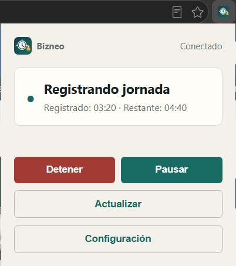
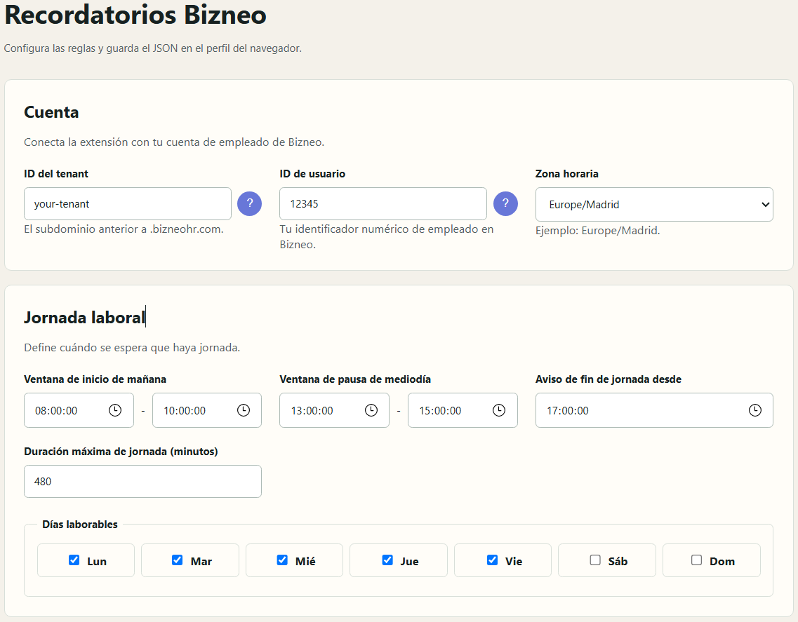

<div align="center">
  
  <h1>Bizneo Reminders</h1>
  <p>Time-tracking reminders for Bizneo on Microsoft Edge and Chrome.</p>
</div>

<div align="center">

[](LICENSE)
[](manifest.json)

</div>

> **Disclaimer:** Bizneo Reminders is an independent, community-developed project. It is not affiliated with, sponsored by, endorsed by or officially connected to Bizneo or Bizneo HR.

## Features

### Status at a glance

- Reads the clock state: stopped, recording a workday or on break.
- Displays registered and remaining time.
- Lets you start, stop, pause and resume the workday from the popup.

<div align="center">

</div>

### Alerts

- Reminds you when the morning check-in is missing.
- Reminds you when the midday break has not started.
- Reminds you when a break exceeds its configured limit.
- Reminds you when the workday should end or the maximum duration is reached.
- Repeats reminders at a configurable interval.
- Runs in the background through browser alarms, without requiring a Bizneo tab to remain open.

### Configuration

- **Account:** configure the Bizneo Tenant ID, User ID and IANA time zone.
- **Working days:** choose which days of the week are treated as workdays.
- **Morning check-in:** define the start and end of the window in which the morning check-in reminder is active.
- **Midday break:** define the start and end of the window in which the break reminder is active.
- **End of day:** configure when the end-of-day reminder starts and the maximum workday duration in minutes.
- **Break duration:** set the maximum break length in minutes before a reminder is triggered.
- **Reminder schedule:** set how often Bizneo is checked, with a minimum interval of 30 seconds.
- **Individual alerts:** enable or disable reminders for the morning check-in, midday break, overdue break and end of day independently.
- **Advanced configuration:** import or export the complete configuration as JSON.

<div align="center">

</div>

### Technical details

- Manifest V3 extension for Chromium-based browsers.
- Uses the active browser session through `credentials: include`; credentials and tokens are not stored by the extension.
- Requests access only to `https://*.bizneohr.com/*`.
- Parses the Bizneo `hub_chrono` widget to determine the current clock state.

### Translations

- Languages available: English and Spanish.

## Installation for Microsoft Edge

1. Open the project's [Releases](../../releases) page.
2. Download the latest `bizneo-reminders.zip` asset.
3. Extract the ZIP file to a permanent folder. Do not delete this folder after installation.
4. Open `edge://extensions` in Microsoft Edge.
5. Enable **Developer mode** using the switch in the bottom-left corner.
6. Click **Load unpacked**.
7. Select the extracted extension folder, the one containing `manifest.json`.
8. Open the extension's **Details** page and pin it to the toolbar if needed.

The CRX file is intended for supported enterprise or developer-mode deployment. Edge may reject a locally generated CRX with `CRX_REQUIRED_PROOF_MISSING`; the ZIP and **Load unpacked** flow are the supported installation path for a regular user.

After installation, open the extension settings and enter the Tenant ID, User ID, time zone and work schedule. You must also have an active Bizneo session in the same Edge profile.

## Browser and language support

- **Microsoft Edge:** supported through Manifest V3 and the documented **Load unpacked** installation flow.
- **Google Chrome:** supported as a Chromium Manifest V3 extension; use the equivalent `chrome://extensions` developer-mode flow for local installation.
- **Languages:** English and Spanish are included. The browser's preferred language determines the extension language when supported.

Browser behavior, extension policies and Bizneo's internal routes may change without notice.

## Configuration

Open **Settings** from the popup or from the extension details page. The configuration is divided into:

- **Account:** Tenant ID, User ID and IANA time zone.
- **Work schedule:** morning and break windows, working days and maximum work duration.
- **Reminders:** individual rule switches and the maximum break duration.
- **Notifications:** check interval in seconds.
- **Advanced JSON:** editing and exchanging the complete configuration.

Minimal example:

```json
{
  "version": 1,
  "tenant": "your-tenant",
  "userId": "123456",
  "timeZone": "Europe/Madrid",
  "reminderIntervalSeconds": 600,
  "workingDays": [1, 2, 3, 4, 5],
  "morningStart": { "start": "08:00", "end": "10:00" },
  "morningBreak": { "start": "13:00", "end": "15:00" },
  "pauseMaximumMinutes": 55,
  "endOfDayStart": "17:00",
  "maximumWorkMinutes": 480,
  "enabled": {
    "morningStart": true,
    "morningBreak": true,
    "pauseOverdue": true,
    "endOfDay": true
  }
}
```

## Why it exists

Keeping an accurate record of working hours is an important obligation for companies and employees in Spain. Article 34.9 of the [Spanish Workers' Statute](https://www.boe.es/buscar/act.php?id=BOE-A-2015-11430&p=20251204&tn=1#a34), introduced by Royal Decree-Law 8/2019, requires employers to guarantee a daily record of working time, including the specific start and end time, and to retain those records for four years.

In that context, correcting a record should not be treated as something a worker can simply change directly; it should follow the employer's approval and audit process. The article discusses an evolving framework, so the final requirements depend on the applicable legislation and regulations.

That makes accurate clock-in, break and clock-out habits more important. Bizneo Reminders helps by notifying the employee at the appropriate time, while leaving every clock action under the employee's manual control. It does not modify records automatically, replace Bizneo's official system or provide legal advice.

> The legal information above is general context, not legal advice. Requirements may depend on current legislation, collective agreements and each company's policies.

## How it works

The extension is a Manifest V3 application made up of:

- `service-worker.js`: queries Bizneo, evaluates rules, schedules alarms and sends notifications.
- `popup.html`: displays the current state and provides manual clock actions.
- `options.html`: configures the account, schedule, rules and notifications.
- `src/parser/`: parses the HTML from the `hub_chrono` widget.
- `_locales/`: English and Spanish translation catalogs.
- `res/`: icons and visual resources used by the extension.

## Developer guide

### Requirements

- Node.js 20 or newer.
- npm.
- A Chromium-based browser for manual validation.
- An active Bizneo test account for end-to-end validation.

### Install dependencies

```bash
npm ci
```

### Test and type-check

```bash
npm test
npm run build
```

The tests cover clock-state parsing, configuration migration, reminder windows, break and maximum-work thresholds, and non-working days.

### Build the unpacked extension

```bash
npm run bundle
```

The loadable extension is written to `dist/`. Use that directory with the browser's **Load unpacked** action.

### Create packages

```bash
npm run package:crx
```

This creates:

- `release/bizneo-reminders.crx`: CRX3 package.
- `release/bizneo-reminders.zip`: distributable extension archive.
- `release/bizneo-reminders.pem`: private signing key.

Keep the PEM key private and reuse it for future packages if the extension ID must remain stable. Never commit it or send it to third parties.

The complete local pipeline is also available through:

```bash
./build.sh
```

The GitHub Actions workflow runs tests, type-checking and packaging on every push and pull request. Pushes also create a GitHub Release with the ZIP package.

### Development structure

- `src/client.ts`: Bizneo API client.
- `src/config.ts`: configuration model and validation.
- `src/reminders.ts`: reminder rules and scheduling decisions.
- `src/service-worker.ts`: background extension entry point.
- `src/popup.ts`: popup entry point.
- `src/options.ts`: options page entry point.
- `test/`: automated tests.

Validation against a real Bizneo account should use a test account. Do not commit cookies, tokens or HTML containing personal data.

## Privacy and security

- The extension only requests access to `https://*.bizneohr.com/*`.
- Bizneo credentials are not included in the configuration or repository.
- Retrieved data is used to calculate the current state and display reminders.
- The user confirms manual workday stop actions.
- The alarms do not perform automatic clock actions.

## License

Distributed under the [MIT License](LICENSE). Copyright (c) 2026 Guillermo Rodríguez.
